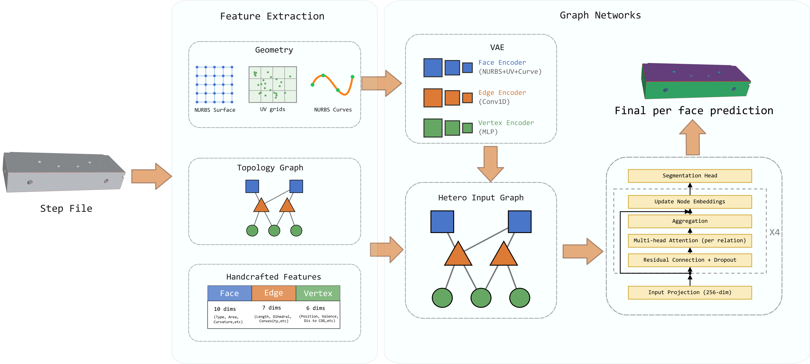
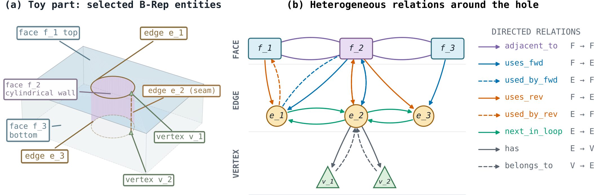

# TopoGNN

Official implementation of **TopoGNN: Heterogeneous B-Rep graph learning with NURBS-based geometric embeddings for industrial machining feature recognition**, published in *Computer-Aided Design* (2026).

TopoGNN learns machining features and part classes directly from STEP CAD models. It represents each boundary representation (B-Rep) as a graph of faces, edges, and vertices, combining learned geometric embeddings with handcrafted descriptors. A heterogeneous GATv2 network predicts either a label for each face or a class for the whole part.

**Paper:** [TopoGNN: Heterogeneous B-Rep graph learning with NURBS-based geometric embeddings for industrial machining feature recognition](https://doi.org/10.1016/j.cad.2026.104175) · *Computer-Aided Design*, 2026.

[Installation](#installation) · [Datasets](#datasets) · [Fusion 360](#reproducing-the-fusion-360-result-tables-4-6) · [TMCAD](#reproducing-the-tmcad-result-tables-7-12-13) · [Citation](#citation)



*The segmentation pipeline. Face, edge, and vertex VAEs encode geometry; their embeddings are combined with handcrafted features before graph learning. For part classification, a pooled graph readout replaces the face prediction head.*

## Results

The repository includes preprocessing, training scripts, and saved test metrics for the two public benchmarks used in the paper.

| Benchmark | Task | Accuracy | Macro F1 | mIoU |
|---|---|---|---|---|
| Fusion 360 Gallery | Per-face MFR (8 classes) | **0.9721** | **0.9292** | **0.8757** |
| TMCAD             | Part classification (10 classes) | **0.8850** | **0.8820** | – |

The paper also evaluates a proprietary industrial dataset, which is not available for redistribution.

## Graph representation

Faces, edges, and vertices form three node types. Directed relations record face adjacency, oriented face–edge incidence, edge order around boundary loops, and edge–vertex incidence.



*The cylindrical hole illustrates why orientation matters: its seam edge belongs to the same face in both traversal directions. The graph preserves both relations. Dashed arrows show inverse incidence relations.*

## Repository layout

```text
TopoGNN/
├── environment.yml             # conda environment (PyTorch + PyG + pythonocc-core)
├── fusion360/                  # Fusion 360 Gallery (per-face MFR)
│   ├── extract_nurbs.py        # NURBS / UV / boundary-curve extraction
│   ├── extract_handcrafted.py  # 17/8/8-D handcrafted descriptors
│   ├── train_face_vae.py       # Self-supervised face VAE
│   ├── train_edge_vae.py       # Self-supervised edge VAE
│   ├── train_vertex_vae.py     # Self-supervised vertex VAE
│   ├── merge_embeddings.py     # Merge per-entity embeddings into per-model files
│   ├── build_graphs.py         # Assemble the heterogeneous B-Rep graphs
│   ├── train_gatv2.py          # Relation-aware GATv2 classifier
│   ├── encoder_utils.py        # Shared VAE / encoder modules
│   ├── train_test.json         # Official Fusion 360 split
│   ├── utils/                  # OCC helpers + scaling utilities
│   ├── scripts/
│   │   ├── run_full_pipeline.sh   # Reproduces the Full model row
│   │   └── run_ablations.sh       # Reproduces Tables 8–11
│   └── results/                # Reference test metrics (results.json)
├── tmcad/                      # TMCAD (part-level classification)
│   ├── extract_nurbs.py
│   ├── extract_handcrafted.py
│   ├── train_face_vae.py / train_edge_vae.py / train_vertex_vae.py
│   ├── merge_embeddings.py
│   ├── build_graphs.py         # Graph-level labels, edge-based variant
│   ├── train_gatv2.py          # Graph-classification GATv2
│   ├── generate_split.py       # Stratified 70/15/15 split
│   ├── mechcad_split.json      # The split used in the paper
│   ├── visualize_embeddings.py # t-SNE + linear-probe diagnostics
│   ├── run_experiment.py       # Multi-seed runner (mean ± std)
│   ├── scripts/run_full_pipeline.sh
│   └── results/
└── docs/figures/               # Pipeline and B-Rep graph illustrations
```

## Installation

The pipeline depends on `pythonocc-core` for STEP parsing, on `torch_geometric`
for the heterogeneous GNN, and on `occwl` for UV grid sampling. The provided
conda environment provides the CAD and learning dependencies. Install `occwl`
separately after activating it:

```bash
conda env create -f environment.yml
conda activate neuronurbs_fusion
pip install occwl    # UV-grid sampling helper
```

The supplied pipeline scripts use `--device cuda` and require a CUDA-capable
GPU. To run on CPU, change the training commands to `--device cpu`; VAE
pretraining will be slower. Run the commands below from the repository root.

## Datasets

| Dataset | Source | Notes |
|---|---|---|
| Fusion 360 Gallery (segmentation) | <https://github.com/AutodeskAILab/Fusion360GalleryDataset> | The `breps/` release ships `step/` files and per-face `seg/` labels. We use the official train / validation / test split, mirrored in `fusion360/train_test.json`. |
| TMCAD | The TMCAD release of Zou & Zhu, *CAD 2025* (BRT) | 10 part classes, 10,897 STEP files. We use a 70/15/15 stratified split (`tmcad/mechcad_split.json`). See the [TMCAD instructions](tmcad/README.md) to generate a new split. |

## Reproducing the Fusion 360 result (Tables 4, 6)

After downloading the Fusion 360 Gallery release, run:

```bash
bash fusion360/scripts/run_full_pipeline.sh \
    /path/to/fusion360/breps/step \
    /path/to/fusion360/breps/seg  \
    /path/to/work_dir
```

The script extracts geometry and handcrafted descriptors, pretrains the three
VAEs, merges their embeddings, builds the graphs, and trains the GATv2 classifier.

Training writes metrics to `fusion360/models_topognn_full/results.json`.
Compare them with the [saved paper results](fusion360/results/models_gatv2_newseed/results.json):
accuracy 0.9721, macro F1 0.9292, and mIoU 0.8757. Exact values may vary between runs.

The main Fusion 360 result uses 4 layers, 8 attention heads, and a learning
rate of `5e-4`. The ablations use 6 layers, 4 heads, and `1e-3` throughout.
Their full-model baseline (`models_rhc_baseline`) therefore differs slightly:
0.9722 accuracy, 0.9259 macro F1, and 0.8717 mIoU. Each saved `results.json`
includes the training settings in its `config` field.

### Ablations (Tables 8–11)

After the pipeline has generated the features and merged embeddings, run:

```bash
bash fusion360/scripts/run_ablations.sh /path/to/work_dir "$(pwd)/fusion360"
```

The script emits one model directory per ablation (`models_rhc_*`); the
expected metrics are committed under `fusion360/results/`. Mapping to the paper:

| Variant | Directory | Paper table |
|---|---|---|
| Full model | `models_rhc_baseline` | 8/9/10/11 |
| No handcrafted features | `models_rhc_no_hc` | 8 |
| Handcrafted only | `models_rhc_hc_only` | 8 |
| Face-only graph | `models_rhc_face_only` | 9 |
| No edges | `models_rhc_no_edges` | 9 |
| No vertices | `models_rhc_no_vertices` | 9 |
| 5 relations (no loop / vertex-incidence) | `models_rhc_4relations` | 9 |
| UV only | `models_rhc_uv_only` | 10 |
| NURBS only | `models_rhc_nurbs_only` | 10 |
| Simplified model | `models_rhc_simplified` | 11 |
| No VAE pretraining | `models_rhc_no_vae` | 11 |

The `UV only` and `NURBS only` ablations require re-training the Face VAE
with the corresponding branch disabled, then re-running
`merge_embeddings.py` into `embeddings_merged_uv_only` and
`embeddings_merged_nurbs_only`.

The reduced handcrafted descriptor set used in the paper (Table 3) is
selected via the `--keep_*_hc_indices` flags, hard-coded at the top of
[`fusion360/scripts/run_ablations.sh`](fusion360/scripts/run_ablations.sh).

### Handcrafted descriptor sets

The full extractor outputs **17 face / 8 edge / 8 vertex** features. The
paper retains only the compact subset shown in Table 3:

| Entity | Dim | Indices kept | Description |
|---|---|---|---|
| Face   | 10 | 0–8, 16 | 7-class surface-type one-hot, area, aspect ratio, number of boundary loops |
| Edge   | 7  | 0–5, 7  | Absolute / relative length, dihedral (angle, sin, cos), convexity, boundary flag |
| Vertex | 6  | 0–4, 6  | Normalized xyz, distance to centre of gravity, valence, boundary flag |

`build_graphs.py --keep_*_hc_indices` performs this selection.

## Reproducing the TMCAD result (Tables 7, 12, 13)

```bash
bash tmcad/scripts/run_full_pipeline.sh /path/to/tmcad/step /path/to/work_dir
```

The script trains the full TopoGNN classifier (HC + VAE) and the
handcrafted-only ablation. Expected metrics:

| Configuration | Directory | Test acc | Test macro F1 |
|---|---|---|---|
| Handcrafted only | `models_gatv2_edge_handcrafted` | 0.8739 | 0.8710 |
| Full TopoGNN     | `models_gatv2_edge_vae`         | 0.8850 | 0.8820 |

For multiple training seeds and embedding diagnostics, see the
[TMCAD README](tmcad/README.md). The [Fusion 360 README](fusion360/README.md)
describes the individual preprocessing stages.

## Citation

```bibtex
@article{gkrispanis2026topognn,
  title   = {TopoGNN: Heterogeneous B-Rep graph learning with NURBS-based
             geometric embeddings for industrial machining feature recognition},
  author  = {Gkrispanis, Konstantinos and Nousias, Stavros and
             Knezevic-Sorger, Jovana and R{\"o}ver, Claas and Borrmann, Andr{\'e}},
  journal = {Computer-Aided Design},
  pages   = {104175},
  year    = {2026},
  issn    = {0010-4485},
  doi     = {10.1016/j.cad.2026.104175},
  url     = {https://doi.org/10.1016/j.cad.2026.104175}
}
```

## License

Released under the [MIT License](LICENSE). The Fusion 360 Gallery and TMCAD
datasets retain the licenses of their respective providers.
